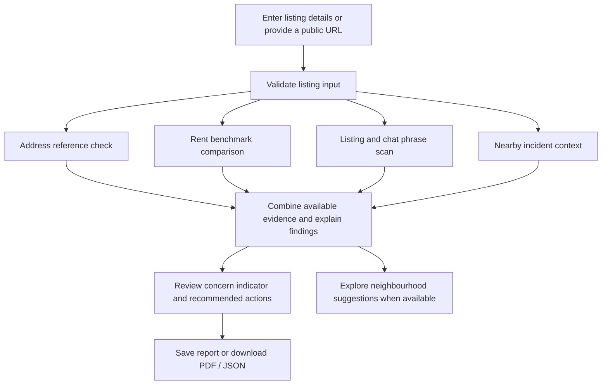

# 🛡️ RentalShield

<p align="center">
  <strong>Found a rental? Check the evidence before you pay.</strong><br>
  A renter-focused screening and decision-support web app for reviewing potential rental-listing warning signs.
</p>

<p align="center">
  
  
  
  
</p>

RentalShield brings several kinds of public and user-provided evidence into one workflow: property-address records, rent benchmarks, nearby police-reported incident context, and warning phrases in listing descriptions or landlord conversations. Its goal is to help renters identify what deserves a closer look **before they send money or share sensitive information**.

> **Important:** RentalShield is a prototype screening tool. It is not a rental marketplace, legal or police service, property-ownership registry, or validated scam-prediction model. A result cannot prove that a listing is fraudulent or safe.

---

## ✨ Why RentalShield?

Rental information is spread across listing websites, public datasets, and private conversations. RentalShield puts several checks into one place and explains what the evidence can—and cannot—tell a renter.

### What it checks

| Evidence area | What RentalShield reviews | What the result does **not** prove |
|---|---|---|
| **Address match** | Whether the entered address appears in the available Downtown Vancouver or West End reference data | Property ownership, advertiser authority, or current unit availability |
| **Rent benchmark** | How the entered rent compares with a Statistics Canada Vancouver Census Metropolitan Area (CMA) benchmark for the selected bedroom category | The exact market value of a specific unit or the rent in a specific neighbourhood |
| **Nearby incident context** | Reported incident records near a matched address, compared with sampled Vancouver address areas | That a listing or landlord is fraudulent, or that a location is definitively safe or unsafe |
| **Listing/chat language** | Configured warning phrases, such as pressure to pay before viewing or unusual payment requests | That a message without flagged wording is genuine |

### Core features

- **Account access and saved reports** using Flask-Login and SQLite.
- **Manual listing entry** for address, neighbourhood, rent, bedroom count, and description.
- **Best-effort URL extraction** with Playwright for some publicly accessible listing pages.
- **Explainable checks** that show evidence and recommended next steps.
- **Nearby crime context** using approximately 500-metre areas and comparison data built from City of Vancouver address points.
- **Neighbourhood suggestions** when the app's configured criteria are met. These are areas to research—not verified rental listings.
- **PDF and JSON report downloads** for later review.
- **Analytics dashboard** with descriptive charts, data summaries, and data-quality context.
- **Leaflet map** using CARTO basemap tiles with OpenStreetMap/CARTO attribution.

## 🧭 How it works



The core checks are rule-based and intended to be explainable. RentalShield does **not** currently train a machine-learning model that predicts the probability a listing is a scam.

## 📊 Understanding the concern indicator

RentalShield displays a provisional, rule-based concern indicator based on configured checks. It is a **heuristic**, not a probability or percentage chance of fraud, and it has not been calibrated against a labelled dataset of verified rental scams.

The report is only as complete as the evidence available for that submission. A check that could not be completed may not contribute to the displayed total, so an incomplete assessment can understate concern. Review the component explanations and recommended actions instead of relying on a single number.

The exact scoring weights are maintained in [`risk_engine.py`](risk_engine.py). Treat those rules as implementation details that can change between versions; confirm the current code and component breakdown before comparing scores across runs or describing them as predictive.

### Interpreting individual checks

- **No address match** is not proof of fraud. The source data may be incomplete or the address format may differ.
- **A rent difference** is a reason to investigate the listing details, not proof of fraud.
- **High nearby incident counts** describe reported incidents around an area; they do not establish anything about a specific landlord or listing.
- **No text warnings detected** only means that the configured patterns did not match the text supplied.
- **A successful address match** does not verify ownership, permission to rent, or availability.

## 📍 Crime-context method

The crime checker uses the supplied Vancouver Police Department GeoDASH incident export and City of Vancouver property-address points. It counts reported incident records within approximately **500 metres** of the matched address and compares the combined period with counts around sampled address points across Vancouver.

The default user-facing period described by the project data combines **2023, 2024, 2025, and 2026 year-to-date**. **2026 is partial-year data** and should not be interpreted as a complete year.

The Low / Medium / High labels are RentalShield-defined relative bands based on the distribution of counts around sampled reference points. A percentile position is **not** the percentage of all Vancouver crime that occurred near an address, and it is not a population-adjusted crime rate.

Important cautions:

- The data covers police-reported incidents, not every incident that occurred.
- Coordinates can be generalized or offset for privacy.
- Repeated-looking rows may exist; data-quality outputs flag records for review but do not automatically establish that every flagged row is a duplicate incident.
- City address points are not rental-unit locations, current inventory, or population-weighted samples.
- The resulting label is not an official police safety rating.

## 🏘️ Neighbourhood suggestions

When the current rules trigger the feature and adequate comparison data is available, RentalShield may suggest neighbourhoods to explore based on nearby incident-count summaries and proximity criteria.

These suggestions **are not available apartments**. The supplied datasets do not establish current rental availability or neighbourhood-specific rent averages. The monthly rent entered by the user is a search target, not a verified price for a suggested area.

## 🧰 Technology stack

| Layer | Tools |
|---|---|
| Backend | Python, Flask |
| UI | HTML, CSS, JavaScript, Jinja templates |
| Maps | Leaflet, CARTO basemap tiles |
| Database and ORM | SQLite, Flask-SQLAlchemy |
| Authentication | Flask-Login, Werkzeug password hashing |
| CSRF protection | Flask-WTF |
| Listing-page extraction | Playwright / Chromium (best effort) |
| Data analysis | pandas, NumPy |
| Spatial processing | pyproj, SciPy `cKDTree` |
| Charts and EDA | Chart.js, Matplotlib |
| Report export | ReportLab |
| Configuration | python-dotenv |

## 🚀 Run locally

These instructions are written for Windows PowerShell.

### 1. Clone the repository

```powershell
git clone https://github.com/GayathriS1429/Rental_Shield_Sparklers_14.git
cd Rental_Shield_Sparklers_14
```

### 2. Create and activate a virtual environment

If you already have a working `rental_venv`, activate it instead of creating another one.

```powershell
python -m venv rental_venv
.\rental_venv\Scripts\Activate.ps1
```

### 3. Install Python dependencies

```powershell
python -m pip install --upgrade pip
pip install -r requirements.txt
```

Install Chromium for Playwright listing extraction if it is not already available:

```powershell
python -m playwright install chromium
```

### 4. Configure environment variables

Create a `.env` file in the same directory as `app.py`. Use your own values; do not commit this file.

```env
SECRET_KEY=replace_with_a_long_random_secret
CARTO_BASEMAP_API_KEY=your_carto_basemap_key
FLASK_DEBUG=1
COOKIE_SECURE=0
```

Generate a Flask secret key locally:

```powershell
python -c "import secrets; print(secrets.token_hex(32))"
```

Replace the example `SECRET_KEY` with the generated value. The CARTO basemap key is included in browser requests, so restrict its allowed website/referrer origins and usage in your CARTO settings. Set `FLASK_DEBUG=0` and use HTTPS-appropriate cookie settings for a production deployment.

### 5. Confirm the required data files

The core address, rent, and crime checks expect these files:

```text
data/property_addresses_downtown.csv
data/property_addresses_west_end.csv
data/rent_benchmark_1br_q2_2026.csv
data/rent_benchmark_2br_q2_2026.csv
data/rent_benchmark_3br_q2_2026.csv
data/police_crime/citywide_reference/crimedata_csv_AllNeighbourhoods_AllYears.csv
data/police_crime/citywide_reference/vancouver_property_addresses.csv
```

The two pilot-area property-address CSV files use semicolon separators. Keep downloaded source files unchanged; the processing scripts write derived outputs separately.

### 6. Build the citywide crime comparison baseline

Run this after adding the citywide source CSVs, or when the baseline data/format changes:

```powershell
python build_citywide_crime_baseline.py
```

The script writes 500-metre reference-count files and metadata under `data/police_crime/citywide_reference/processed/`. Processing can take several minutes. Wait for the final completion message before testing the crime checker.

### 7. Prepare analytics outputs if needed

If the Analytics page reports that its data is unavailable, check the source files expected by the EDA pipeline and run:

```powershell
python rentalshield_eda.py
```

The outputs are written to `analytics/eda_outputs/`.

### 8. Start the application

```powershell
python app.py
```

Open the local URL shown in the terminal, usually:

```text
http://127.0.0.1:5000/
```

### Typical user flow

1. Register and sign in.
2. Paste a public rental URL and try **Fetch Listing Details**, or enter the information manually.
3. Review the address, rent, bedroom count, neighbourhood, and listing description.
4. Run the rental checks.
5. Read the evidence summaries, concern indicator, and recommended actions.
6. Review any neighbourhood suggestions shown.
7. Save the report in your dashboard or download it as PDF / JSON.

URL extraction is best-effort. If a site blocks automated access, times out, or changes its page structure, enter the information manually.

## 📈 Analytics and exploratory data analysis

The `/analytics` page uses `analytics_dashboard.py` to display summaries built from `analytics/eda_outputs/`. Depending on the available inputs, it includes:

- Annual, monthly, area, and incident-category summaries.
- Charts for reported incident patterns and selected data-quality checks.
- A completed-year comparison for 2023–2025, with 2026 treated as partial-year data.
- Rent benchmark values and an interactive rent comparison.
- Address-reference coverage and notes about dataset limitations.
- Context on why broad fraud-report datasets do not support a local, address-level rental-scam rate.

These charts are descriptive summaries of the supplied data. They are not proof that a particular property is safe or fraudulent.

## 🗃️ Database and saved reports

RentalShield uses SQLite through Flask-SQLAlchemy. The database is normally created at:

```text
instance/rentalshield.db
```

- **`User`** stores account details and a password hash rather than a plain-text password.
- **`VerificationReport`** stores report ownership, listing details, serialized report JSON, and a creation timestamp.

Reports are snapshots of results at the time of checking. Changes to scoring rules or source data do not automatically recalculate reports that were already saved.

## 🗂️ Repository layout

```text
Rental_Shield_Sparklers_14/
├── app.py                              # Flask application and routes
├── models.py                           # SQLAlchemy models
├── risk_engine.py                      # Concern indicator and next-step logic
├── address_checker.py                  # Address normalization and matching
├── rent_checker.py                     # Rent benchmark comparison
├── listing_analyzer.py                 # Listing/chat phrase checks
├── crime_checker.py                    # Nearby incidents and comparison context
├── data_loader.py                      # Data-loading helpers
├── build_citywide_crime_baseline.py    # Builds the spatial comparison baseline
├── analytics_dashboard.py              # Analytics-page context
├── rentalshield_eda.py                 # Prepares analytics outputs
├── rental_issue_checker.py             # Additional rental-issue checks
├── requirements.txt                    # Python dependencies
├── data/                               # Source and derived data files
├── analytics/eda_outputs/              # Charts, summaries, and EDA outputs
├── templates/                          # Jinja HTML templates
├── static/                             # Static assets
└── docs/README_RentalShield.md         # Extended project documentation
```

Local-only files such as `.env`, virtual environments, and the SQLite database should remain untracked. The repository includes large data files, so cloning or pushing the repository may take longer than a code-only project.

## 🔐 Security and configuration

- Keep `.env`, API keys, passwords, database files containing user information, and session secrets out of Git.
- Do not share a real `SECRET_KEY` in screenshots, issues, or documentation.
- Restrict the CARTO key by referrer/domain and usage because the key appears in browser requests.
- Use `FLASK_DEBUG=0` outside local development and configure secure cookies appropriately for HTTPS deployment.
- Use a non-production test account when demonstrating the app publicly.

Example `.gitignore` entries:

```gitignore
.env
.env.*
!.env.example
.venv/
venv/
env/
rental_venv/
__pycache__/
*.py[cod]
instance/
*.db
*.sqlite
*.sqlite3
*.bak
```

## 🛠️ Troubleshooting

<details>
<summary><strong>Address verification could not be completed</strong></summary>

- Check that the civic number and street fields are populated separately.
- Select Downtown or West End, or leave the area blank if the app supports searching both pilot datasets.
- Confirm that `data/property_addresses_downtown.csv` and `data/property_addresses_west_end.csv` exist and contain the expected columns.
- Check whether the street name can be normalized to the source data's `STD_STREET` format.

A missing match is not proof of fraud.
</details>

<details>
<summary><strong>Nearby crime context is unavailable</strong></summary>

- Confirm both citywide source CSVs exist in `data/police_crime/citywide_reference/`.
- Confirm the expected per-year files exist under `processed/`.
- Re-run `python build_citywide_crime_baseline.py` if the baseline is missing or uses an incompatible format.
- Check that the matched address has usable coordinates and maps to the supported pilot area.
</details>

<details>
<summary><strong>No neighbourhood suggestions appear</strong></summary>

Suggestions require a qualifying concern level, usable matched-address coordinates, and enough comparable crime-context data. The app does not invent suggestions when no area satisfies the configured criteria.
</details>

<details>
<summary><strong>The Analytics page says data is not ready</strong></summary>

Run `python rentalshield_eda.py`, then check the output files in `analytics/eda_outputs/` and read any warnings printed in the terminal.
</details>

<details>
<summary><strong>Listing URL extraction fails</strong></summary>

The site may block automated access, time out, or change its layout. Try entering the address, rent, bedroom count, and description manually. A fetch failure does not mean a listing is fraudulent.
</details>

<details>
<summary><strong>The map reports an API-key problem</strong></summary>

Check `CARTO_BASEMAP_API_KEY` in the project-root `.env`, confirm the app passes it to the map template, verify the key's allowed referrers/usage, restart Flask, and hard-refresh the page. The key is browser-visible and should be restricted.
</details>

To check Python syntax after changing core files, run:

```powershell
python -m py_compile app.py models.py risk_engine.py address_checker.py rent_checker.py listing_analyzer.py crime_checker.py data_loader.py analytics_dashboard.py build_citywide_crime_baseline.py rentalshield_eda.py
```

If the project version includes a `/health` route, opening `/health` on the running server should return a small JSON response confirming the app is reachable.

## ⚖️ Responsible use and limitations

1. **Not a validated fraud model.** The concern indicator is rule-based and has not been statistically calibrated against verified rental-scam outcomes.
2. **No ownership or authority verification.** Address presence does not verify the landlord, agent, owner, or permission to rent.
3. **Incomplete checks can understate concern.** Review the component-level findings and note checks that could not be completed.
4. **Rent data is CMA-wide.** It is not an appraisal of a particular unit or a neighbourhood-specific average.
5. **Crime data is contextual.** It is not population-adjusted and does not establish that a person, property, or listing is unsafe or fraudulent.
6. **No current rental inventory.** Neighbourhood suggestions do not mean that apartments are available at the entered rent.
7. **Text checks are limited.** Pattern matching can miss sophisticated scams or flag legitimate messages that need context.
8. **URL extraction is best-effort.** Respect website terms, applicable laws, and access restrictions.
9. **Source data changes.** Record source periods when publishing results and rebuild derived outputs when input data or processing logic changes.

Use RentalShield as one part of a broader verification process. Independently confirm the property, the advertiser's authority, viewing arrangements, written tenancy terms, recipient of any payment, and applicable deposit rules before transferring money or sensitive information. Avoid publicly accusing a named person or business based solely on an automated report.

## 🧪 Future improvements

- Add automated tests for address normalization, scoring rules, missing-data handling, and crime summaries.
- Version the scoring rules and source data dates in each saved report.
- Evaluate thresholds with domain expertise and responsibly reviewed examples before making predictive claims.
- Investigate authoritative and legally appropriate ways to verify landlord or manager authorization.
- Add permitted rental inventory or area-specific rent data if the project later needs availability-aware suggestions.
- Improve accessibility, mobile experience, and structured error logging.

These are potential enhancements, not claims of functionality already delivered.

## 🔗 Data sources and guidance

- [City of Vancouver — Property Addresses](https://opendata.vancouver.ca/explore/dataset/property-addresses/)
- [Vancouver Police Department — GeoDASH Open Data](https://geodash.vpd.ca/opendata/)
- [Statistics Canada — Table 46-10-0092-01](https://www150.statcan.gc.ca/t1/tbl1/en/tv.action?pid=4610009201)
- [B.C. RCMP — Rental Scams](https://rcmp.ca/en/bc/safety-tips/frauds-and-scams/rental-scams)
- [Richmond RCMP — Rental Deposit Scam Warning](https://rcmp.ca/en/bc/richmond/news/2025/08/richmond-rcmp-warns-public-about-rental-deposit-scams)
- [Competition Bureau Canada — Fraud and Scams](https://competition-bureau.canada.ca/en/fraud-and-scams/tips-and-advice/how-report-fraud-and-scams-canada)

## 👥 Project summary

**RentalShield combines public-data evidence checks, listing-language screening, a saved-report workflow, and analytics to help renters decide what to verify next.** Its value is not a guarantee of safety; it is a more organized way to review fragmented evidence before paying.

---

<p align="center"><sub>Built as a prototype with a focus on responsible, explainable rental-listing screening.</sub></p>
